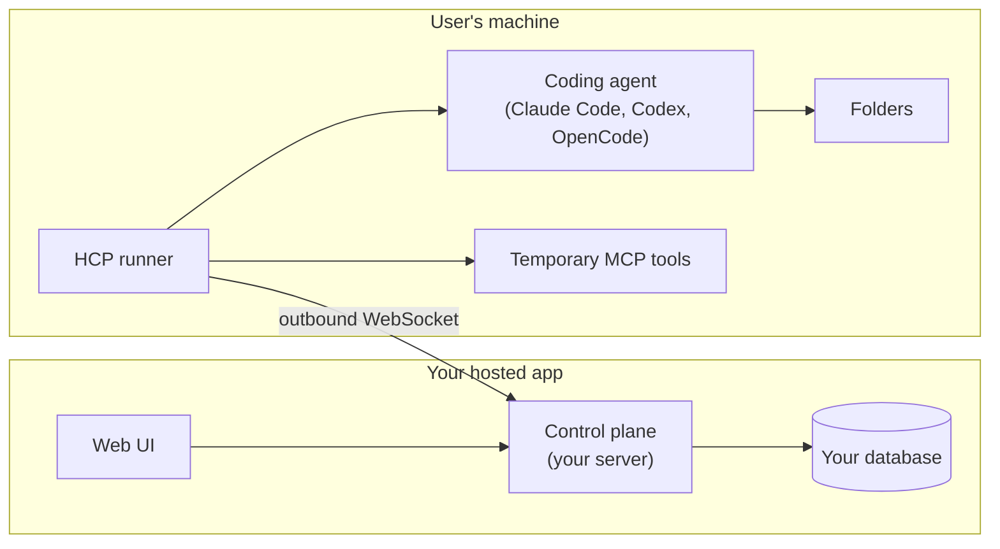

# Concepts

**Who this is for:** everyone. Read this first; every other doc uses these words.

## The picture

- The **runner** starts the connection. The user's machine needs no open port.
- Your app sends **commands** down the socket. The runner sends **events** back.
- The runner is the local trust boundary. It only does what its local settings allow, whatever the app asks.

## Words

| Word | Meaning |
| --- | --- |
| **Control plane** | The server side, run by your app. It pairs machines, accepts runner sockets, sends commands and stores events. There is no central HCP service. |
| **Runner** | The `hcp-runner` program on the user's machine. It drives the local coding agents. |
| **Runner id / host id** | `runner_id` names one runner installation. `host_id` names the machine it reports. Both are labels the credential is bound to, not hardware proof. |
| **Pairing** | The one-time flow that turns a runner into a machine owned by a signed-in user. See [pairing](pairing.md). |
| **Credential** | The long-lived secret a runner gets from pairing. It is used only to get connection tokens. |
| **Credential generation** | A number your server raises when a machine is revoked or paired again. Anything issued under an older number is refused. |
| **Connection token** | A short-lived, single-use token that admits one WebSocket. |
| **Provider instance** | One coding agent set up on the runner, such as `claude` or `codex`. Its `driver_kind` names the adapter that drives it. |
| **Capabilities** | What the runner reports it can do: agents, models, folders and features. Sent in `host.capabilities.updated`. Missing means unknown, not "no". |
| **Provider setup** | Installing the runner's tested version of a coding agent, locally with `hcp-runner providers install` or from your app with `setupProvider` when the machine allows it. See [installing coding agents](provider-setup.md). |
| **Workspace** | A folder the user has allowed on that machine. Your app adds folders with `manageWorkspaces`; the runner checks them against its local allowed roots. |
| **Session** | One run of a coding agent in one workspace, started by `harness.session.start`. |
| **Turn** | One prompt and its answer inside a session, sent by `harness.turn.send`. |
| **Command** | A message from your app to the runner. It is answered by an **ACK** (accepted) or a **NACK** (refused). An ACK does not mean the work is finished. |
| **Event** | A message from the runner about a session. Events are numbered per session (`sequence`). |
| **Terminal event** | The event that ends a turn: `turn.completed`, `turn.failed`, `turn.aborted` or `turn.cancelled`. |
| **Replay cursor** | The last event sequence your app has durably stored. You send it in `host.accepted`, and the runner replays what came after it. |
| **Snapshot** | A full or partial copy of a session's events, used to recover after a gap. |
| **Execution profile** | A named way a provider can run, such as `isolated` or `interactive`, with its own declared controls. See [provider support](native-providers.md). |
| **MCP attachment** | A temporary MCP tool server your app attaches to a session. The runner enforces its allowed and denied tools. |
| **Lease** | A time-limited grant your app issues for MCP tools or local actions. The runner checks it; your app mints and revokes it. |
| **Schema digest** | `protocol_schema_sha256`, which tells your server which protocol build a runner speaks, so you can admit only versions you tested. |

## Packages

| Package | Who installs it | What it is |
| --- | --- | --- |
| `@harness-control/protocol` | Apps and runners | Message types, validation, JSON Schemas and the event reducer |
| `@harness-control/sdk` | Apps (TypeScript) | Typed commands and one connection per socket |
| `@harness-control/runner` | Users' machines | The CLI, agent adapters, and `check-control-plane` |

Apps in other languages use the JSON Schemas in `@harness-control/protocol` and the [lifecycle checks](control-plane/lifecycle.md#run-the-checks).
