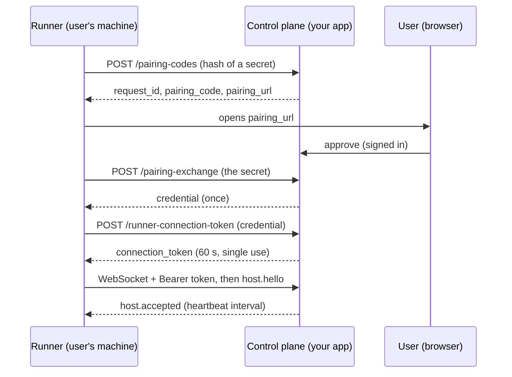
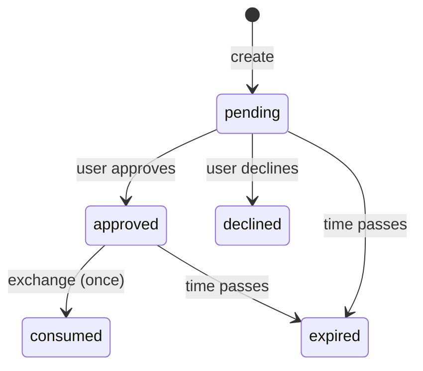

# Control-plane lifecycle spec

**Who this is for:** anyone building or reviewing the server side of HCP (the *control plane*).
**What you get:** the exact states, the steps that must be atomic, and the checks that prove your server follows them.

**Level:** 1. Every app needs this before it can run anything.

HCP has no central service. Each app runs its own control plane and writes this code itself, in any language. HCP owns this spec, the [pairing JSON Schema](../../packages/hcp-protocol/schemas/pairing.schema.json) and the [lifecycle checks](#run-the-checks) that prove an app follows it.

## Who owns what

| Part | Owner |
| --- | --- |
| Who the user is and whether they may approve a machine | Your app |
| Pairing, exchange, tokens, generations and fencing, as specified here | Your app's code, checked against this spec |
| The record "this machine belongs to this user" | Your app's database |
| When to revoke (someone leaves, an admin removes a machine) | Your app |
| The wire formats, this spec and the checks | HCP |

## The flow



The bodies of the three HTTP calls are defined in [`pairing.schema.json`](../../packages/hcp-protocol/schemas/pairing.schema.json). Its `x-hcp-endpoints` list maps each path to its request and response. WebSocket messages are in [`hcp-message.schema.json`](../../packages/hcp-protocol/schemas/hcp-message.schema.json).

## URLs

- The runner is given one URL: the WebSocket URL, for example `https://app.example.com/hcp/runner`. It may have a path.
- The three HTTP endpoints are rooted at the **origin** of that URL, for example `https://app.example.com/pairing-codes`.
- The `control_plane_url` in the exchange response and in the credential must equal the URL the runner was given. Runners refuse any other value.
- Remote URLs must use HTTPS and WSS. Plain HTTP is allowed only on loopback.

## Pairing states



| State | Exchange answers |
| --- | --- |
| `pending` | `200 {"status":"pending"}`. The runner keeps polling. |
| `approved` | `200` with the credential, then the state becomes `consumed`. |
| `declined`, `consumed`, expired | HTTP 4xx. The runner must start a new pairing. |
| wrong secret, runner_id or host_id | HTTP 4xx. The request is not consumed. |

Rules:

- Store only the **hash** of the pairing code and of the exchange secret.
- A pairing request expires. 5 minutes is a good default.
- Check the approver's permission again when you issue the credential, not only when they click approve.
- Bind the machine to the approving user (and tenant, if you have tenants). Membership of an organisation should not give other users access.

## Credentials and generations

The exchange issues a long-lived **credential**: `credential_id`, `credential_secret` and `mcp_proof_secret`. Store a hash of `credential_secret`, and encrypt `mcp_proof_secret` at rest.

Give each machine a **credential generation** number. Raise it on every revocation or re-pairing. Everything issued later records the generation it was issued under:

- A connection token records the generation it was minted for.
- A live socket records the generation it was admitted with.

Anything whose generation is no longer current is **fenced**: it must be refused.

## Connection tokens

`POST /runner-connection-token` checks the credential and returns a token that:

- expires quickly (60 seconds is a good default);
- works **once**;
- is refused if the machine was revoked after it was minted.

The request carries `protocol_schema_sha256`, the SHA-256 of the runner's installed `hcp-message.schema.json`. Compare it with the digest your server was tested with, and refuse others with HTTP 4xx and a message telling the user to update the runner. This is compatibility admission, not proof of which executable is running.

`demand` in the response is optional. Omit it unless you implement demand-driven wake-up.

## The WebSocket

1. Read `Authorization: Bearer <token>` on the upgrade. Spend the token (see atomic step 2). Refuse the upgrade if that fails.
2. Wait for `host.hello`. Its `runner_id` and `host_id` must match the credential. If not, send `host.rejected` and close.
3. Send `host.accepted` with `heartbeat_interval_seconds` and your durably stored replay cursor, if you have one.
4. Keep **at most one live connection per credential**. Either refuse the newer socket or close the older one; both are valid. Both staying open is not.

## The two atomic steps

These must each be a single atomic operation in your database, because two requests can arrive at the same moment.

| Step | Atomic rule | Postgres or SQLite example |
| --- | --- | --- |
| 1. One-time exchange | Only one exchange can move a request from `approved` to `consumed`, in the same transaction that creates the machine. | `UPDATE pairings SET state='consumed' WHERE request_id=$1 AND state='approved'`, then check exactly 1 row changed |
| 2. Spend a token | Only one connection can use a token, and only while its generation is current. | `UPDATE tokens SET used_at=now() WHERE token_hash=$1 AND used_at IS NULL AND expires_at>now() RETURNING credential_id, generation`, then compare the generation |

Revocation is a plain conditional update: set `revoked_at` and add 1 to the generation.

In Convex, each of these is one mutation. Convex mutations are transactions.

## Revocation

Revoking a machine must:

1. refuse new connection tokens;
2. refuse tokens minted before the revocation;
3. close the live socket.

How fast step 3 happens is your promise to users. Choose one and test for it:

| Approach | Cut-off time |
| --- | --- |
| The process that holds the socket closes it directly. With several server processes, deliver revocation to the right one through pub/sub or a database subscription. | Immediate |
| Check the generation on every runner heartbeat, and close the socket when it is stale. | Up to one heartbeat interval |

Use the heartbeat check as a backstop even if you also close sockets directly.

## Run the checks

The runner package includes a black-box check that acts as a runner over HTTP and WebSocket only, so it works on a control plane written in any language:

```sh
npx @harness-control/runner check-control-plane https://staging.example.com/hcp/runner \
  --hooks https://staging.example.com/test-hooks/ --hooks-token-env HCP_TEST_HOOKS_TOKEN
```

Approving, declining and revoking are product actions, so your server exposes them as **test hooks**, in test environments only:

| Hook | Body | Does |
| --- | --- | --- |
| `POST {hooks}/approve` | `{"request_id", "pairing_code"}` | Approves as a test user |
| `POST {hooks}/decline` | `{"request_id", "pairing_code"}` | Declines |
| `POST {hooks}/revoke` | `{"credential_id"}` | Revokes the machine |

Any 2xx response means done. Protect the hooks with a bearer token (`--hooks-token-env` names the environment variable that holds it). Never enable them in production.

Use `--revoke-timeout-seconds` to set your revocation promise. The default is one heartbeat interval plus 5 seconds. Add `--json` for machine-readable output. The exit code is 0 only when every check passes.

The checks, in order:

| Id | Proves |
| --- | --- |
| `pairing.create` | Creating a pairing request returns a valid pairing code |
| `pairing.create_rejects_invalid` | A malformed pairing request is refused |
| `pairing.exchange_pending` | Exchange before approval reports pending |
| `pairing.exchange_rejects_wrong_secret` | Exchange with the wrong secret is refused |
| `pairing.exchange_approved` | Exchange after approval returns a credential bound to the runner and to the runner URL |
| `pairing.exchange_single_use` | A second exchange of the same request is refused |
| `pairing.declined` | Exchange after decline is refused |
| `token.issue` | A credential gets a short-lived connection token |
| `token.rejects_wrong_secret` | A token request with the wrong credential secret is refused |
| `token.rejects_unknown_schema` | A token request with an unpinned protocol schema digest is refused |
| `socket.rejects_missing_token` | A socket without a connection token is refused |
| `socket.accepts_token` | A socket with a valid token and matching hello is accepted |
| `socket.rejects_reused_token` | A connection token works only once |
| `socket.rejects_identity_mismatch` | A hello whose runner or host differs from the credential is refused |
| `socket.single_live_connection` | At most one live connection per credential |
| `revoke.closes_socket` | Revocation closes the live socket within the promised time |
| `revoke.refuses_tokens` | A revoked credential cannot get new tokens |
| `revoke.refuses_unused_token` | A token issued before revocation cannot connect afterwards |

Not covered yet: pairing expiry (it would need a 5-minute wait or a configurable lifetime), and checking approval authority again at exchange time.

In TypeScript, call `checkControlPlane` from `@harness-control/runner/control-plane-check` with your own hooks object instead of HTTP hooks.

## Known implementations

| Implementation | Result |
| --- | --- |
| [Reference control plane](../../apps/reference-control-plane) | Passes all checks in its test suite. |
| [Mock control plane](../../apps/mock-control-plane) | A development tool for runner tests. It does not pin the protocol schema digest, so `token.rejects_unknown_schema` fails. Do not deploy it. |
